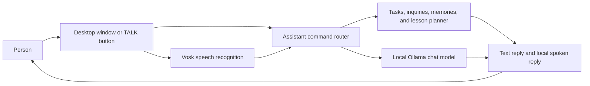

# JARVIS

**A local-first voice assistant prototype for tutor workflows.**

JARVIS combines a desktop chat window, push-to-talk speech, a local language model, and small business tools for independent tutors. It can answer general questions, summarize saved work, track prospective learner inquiries, and prepare introductory Calculus I lessons.

## What it can do

- Chat naturally by typing or pressing **TALK**. The local model can use recent JARVIS replies for follow-up questions during the current session.
- Save a small set of personal preferences or goals across sessions with explicit `remember` commands. Review and remove them at any time.
- Give a daily brief of open tasks and inquiry follow-ups.
- Save tasks and prospective learner inquiries, and record follow-up dates.
- Create curated, 60-minute introductory lessons on limits or derivatives.
- Speak replies with a local neural voice, with the Windows voice available as a fallback. Use **TEST VOICE** to hear a preview.
- Route clear, read-only requests such as “What should I focus on today?” to JARVIS's saved data.

Record-changing operations use explicit commands, so an ambiguous or misheard phrase does not silently edit saved information. JARVIS does not send messages.

## Example interaction

Try saying or typing:

- “What should I focus on today?”
- “Who needs a follow-up?”
- “Plan a lesson on derivatives.”
- “Can you explain the power rule with a simple example?”

For changes to saved records, use clear commands such as:

```text
add prepare a fractions lesson
done 1
inquiry Alex | interested in weekly algebra tutoring
followup 1 2026-11-25
replied 1
remember that I prefer short explanations
memories
forget 1
```

JARVIS only saves a personal detail when you explicitly ask. Say `what do you remember?` to review saved details, `forget 2` (or repeat the exact detail after `forget`) to remove one, and `forget all` to clear them all. Saved memories are kept locally in `data/memory.json` and are included as context for the local chat model. Removing memories also clears the recent chat context and visible transcript.

Type `help` in JARVIS to see the full command list.

## Short demo

1. Open JARVIS and select **TEST VOICE**.
2. Type `remember that I prefer concise explanations`.
3. Ask `what do you remember?`, then type `forget 1` to show that the saved detail can be removed.
4. Ask `plan a lesson on limits` to see a tutor workflow.

Use a made-up preference for the demo. JARVIS's saved-memory file is local and persists after the window closes.

## How it works



Specific commands and common read-only requests use JARVIS's Python code. General questions go to Qwen 3.5 4B through Ollama running on this computer. The model cannot send messages or directly change task and inquiry records.

## Run on Windows

1. Install Python and Ollama for Windows. The local chat feature uses the `qwen3.5:4b` model.
2. In PowerShell, move to the JARVIS project folder and prepare the Python environment. The first setup downloads the speech model into `data/voices/`:

   ```powershell
   python -m venv .venv
   .\.venv\Scripts\Activate.ps1
   python -m pip install -r requirements.txt
   ollama pull qwen3.5:4b
   python -m piper.download_voices en_US-joe-medium --download-dir data/voices
   ```

3. Start the desktop app:

   ```powershell
   python main.py
   ```

Typing works without a microphone. Press **TALK** when you want to speak; JARVIS listens only after the button is pressed and for up to 10 seconds. Use **TEST VOICE** in the desktop window to preview JARVIS's current voice.

## Run checks

From the project folder with `.venv` active, run:

```powershell
python -m unittest discover -s tests -v
```

The automated checks cover task, inquiry, and memory storage plus assistant memory commands.

## Privacy and limits

- Speech recognition, the language model, and neural speech output run locally. JARVIS does not save your microphone audio or spoken reply audio; reply audio is temporary and removed after playback.
- Recent conversation, including command replies that help with follow-up questions, stays in memory until JARVIS closes. It is not written to the data files.
- Personal memories are saved only after an explicit `remember` command, as plain-text JSON in `data/memory.json`. They stay on this computer, are excluded from Git, and can be reviewed or deleted from JARVIS.
- Tasks and inquiries are stored as plain-text JSON under `data/`. Use fictional names and details while developing; the files are excluded from Git.
- The local model can make mistakes and has no live internet access. It is a small local model, not a perfect or all-knowing assistant.
- The lesson planner currently has curated lessons for limits and derivatives. Integrals and calendar connections are future ideas.

## Project structure

- `src/assistant.py` — routes commands, conversational requests, and general chat
- `src/llm_client.py` — local Ollama connection and short-lived conversation context
- `src/memory.py` — opt-in personal memories saved on this computer
- `src/lesson_planner.py` — curated Calculus I lesson plans
- `src/tasks.py` — task operations
- `src/inquiries.py` — inquiry and follow-up operations
- `src/storage.py` — local JSON storage
- `src/voice_input.py` — local push-to-talk speech recognition
- `src/voice_output.py` — local Piper neural voice with Windows fallback
- `src/desktop_app.py` — Tkinter desktop interface
- `data/` — local task, inquiry, and speech-model data

The current Piper speech engine is GPL-3.0-or-later and the selected `en_US-joe-medium` voice is CC0. Review the engine and voice terms again before distributing JARVIS or using it in a commercial release.

## Portfolio summary

JARVIS explores how a local voice assistant can support independent tutors without sending conversations to a hosted chat service. The prototype brings together Python desktop development, offline speech recognition, local language-model chat, structured JSON storage, and explicit command handling for saved business records.
